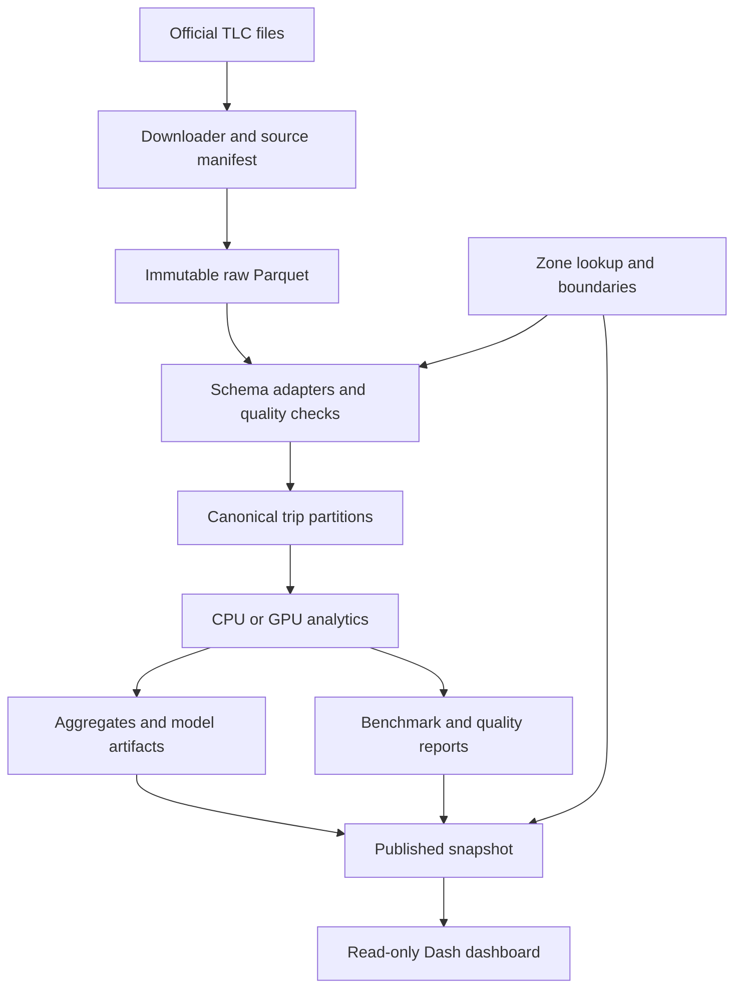

# GPU-Accelerated NYC Urban Mobility Analysis

## Comprehensive system specification and implementation blueprint

**Prepared for:** Jason Perez and the senior project team  
**Specification date:** October 30, 2026  
**Status:** Proposed design; software, trained models, deployment, and measured speedups have not yet been produced.  
**Planning assumption:** A small undergraduate team working over two semesters with access to one NVIDIA GPU server. Adjust the schedule to the actual academic calendar and team size.  
**Primary deliverable:** A reproducible analytics system, an interactive dashboard, and a defensible CPU/GPU experimental evaluation.

> The system will measure how recorded taxi and ride-hailing activity varies across NYC zones and time. It will benchmark large-table processing, clustering, and selected custom CUDA kernels. It will not infer the street route of a taxi, simulate a new road, measure all NYC travel demand, or promise that every algorithm becomes faster on a GPU.

## Contents

1. [Purpose, research questions, and scope](#1-purpose-research-questions-and-scope)
2. [Requirements and acceptance criteria](#2-requirements-and-acceptance-criteria)
3. [Research basis and technology decisions](#3-research-basis-and-technology-decisions)
4. [System architecture and execution model](#4-system-architecture-and-execution-model)
5. [Hardware, operating systems, and environments](#5-hardware-operating-systems-and-environments)
6. [Datasets, acquisition, and provenance](#6-datasets-acquisition-and-provenance)
7. [Storage layers and data contracts](#7-storage-layers-and-data-contracts)
8. [Data quality, cleaning, and time semantics](#8-data-quality-cleaning-and-time-semantics)
9. [Feature engineering and analytical products](#9-feature-engineering-and-analytical-products)
10. [CPU and GPU pipeline implementation](#10-cpu-and-gpu-pipeline-implementation)
11. [Clustering design and evaluation](#11-clustering-design-and-evaluation)
12. [Anomaly detection design and evaluation](#12-anomaly-detection-design-and-evaluation)
13. [Origin–destination graph analysis](#13-origindestination-graph-analysis)
14. [Custom CUDA/C++ work](#14-custom-cudac-work)
15. [Dashboard pages and interactions](#15-dashboard-pages-and-interactions)
16. [Visual design and accessibility](#16-visual-design-and-accessibility)
17. [Application interfaces and command-line contract](#17-application-interfaces-and-command-line-contract)
18. [Configuration and repository organization](#18-configuration-and-repository-organization)
19. [Testing and correctness verification](#19-testing-and-correctness-verification)
20. [Performance experiments and statistical reporting](#20-performance-experiments-and-statistical-reporting)
21. [Reproducibility, logging, and observability](#21-reproducibility-logging-and-observability)
22. [Deployment, security, and operations](#22-deployment-security-and-operations)
23. [Team workflow and two-semester roadmap](#23-team-workflow-and-two-semester-roadmap)
24. [Risks, limitations, and contingency plans](#24-risks-limitations-and-contingency-plans)
25. [Deliverables and demonstration script](#25-deliverables-and-demonstration-script)
26. [Implementation backlog and definition of done](#26-implementation-backlog-and-definition-of-done)
27. [Worked examples and formulas](#27-worked-examples-and-formulas)
28. [Decisions to confirm before implementation](#28-decisions-to-confirm-before-implementation)
29. [Source register](#29-source-register)
30. [Final build checklist](#30-final-build-checklist)

---

## 1. Purpose, research questions, and scope

### 1.1 Problem statement

NYC TLC publishes monthly trip records containing origins, destinations, timestamps, distances, and other trip attributes. These records support analysis of large numbers of individual trips, but a usable system must handle inconsistent schemas, invalid observations, time semantics, large scans, geographic joins, and reproducible experiments. A dashboard alone does not address these engineering problems.

Build a batch processing system that downloads a frozen selection of official files, validates and normalizes the records, computes analytical products on CPU and GPU, and presents understandable results. Separate the scientific claims about mobility from the engineering claims about acceleration.

### 1.2 Research questions

- **RQ1 — Processing:** At what data sizes do GPU implementations of cleaning, feature generation, joins, and group-by aggregation outperform equivalent CPU implementations?
- **RQ2 — Clustering:** Can GPU clustering produce comparably useful trip groupings while reducing fit and prediction time at larger input sizes?
- **RQ3 — Anomalies:** Can a transparent temporal baseline identify meaningful deviations in recorded zone-level activity, with a measured background-alert burden and explicit uncertainty?
- **RQ4 — Custom CUDA:** Does fusing feature calculations or implementing a specialized counting kernel improve throughput relative to both CPU code and existing GPU libraries?
- **RQ5 — Optional graphs:** What passenger-flow structure appears in zone-to-zone movements, and is GPU graph computation worthwhile at this graph size?

A valid result may be that the CPU wins for small datasets or zone graphs. Report those results rather than changing the benchmark until the GPU wins.

### 1.3 Scope tiers

| Tier | Required capabilities | Completion rule |
|---|---|---|
| Core | Yellow taxis, frozen source manifests, CPU pipeline, explicit GPU pipeline, hourly aggregates, one clustering model, one transparent anomaly detector, dashboard, benchmark harness | Must work end to end before adding more algorithms |
| Engineering contribution | At least one CUDA C++ kernel with CPU reference, correctness tests, profiling, and ablation | Agree with the advisor; using RAPIDS alone may not satisfy a CUDA implementation requirement |
| Advanced | High-volume FHV, graph exploration, additional anomaly method, weather context, stronger CPU engine comparison | Add only after core correctness and reproducibility pass |
| Stretch | Distributed processing, larger time-expanded graphs, multi-GPU work | Requires a demonstrated bottleneck and a separately scoped experiment |

### 1.4 Explicit exclusions

No live dispatch, taxi booking, traffic control, road-capacity optimization, user tracking, driver scoring, automatic causal explanation, or citywide transport-demand forecasting in the core build. No raw GPS trajectory reconstruction. No authentication service, Kubernetes deployment, message broker, or online model retraining unless the team obtains a concrete need later.

The dashboard is a read-only analysis interface. The project is historical batch analytics, even if the interface feels interactive.

## 2. Requirements and acceptance criteria

The numerical latency and memory targets below are proposed engineering targets, not measured results. Revisit them after the first profiling milestone, documenting any changes.

| ID | Requirement | Acceptance evidence |
|---|---|---|
| DATA-01 | Fetch official monthly files reliably | Download manifest, byte count, SHA-256, successful Parquet footer read, and resumable/retry behavior |
| DATA-02 | Re-running the same input is safe | Identical source hashes and configuration do not produce duplicate analytical rows |
| DATA-03 | Detect schema drift | Missing required fields fail explicitly; optional fields are recorded as absent; changed dtypes produce a compatibility report |
| DATA-04 | Distinguish missing data from no activity | Coverage status accompanies every zone/time aggregate; absent input never silently becomes zero |
| COR-01 | CPU/GPU calculations are equivalent | Exact integer/count checks; documented floating-point tolerances; shared fixtures |
| COR-02 | Cleaning is auditable | Counts for every rejection/flag reason and reconciliation from input to outputs |
| ANA-01 | Provide trip, zone-hour, and OD analysis | Validated, versioned tables with declared keys and units |
| ANA-02 | Fit a reproducible clustering model | Saved features, scaler, initialization, parameters, training split, and evaluation report |
| ANA-03 | Score temporal anomalies without leakage | Chronological training/calibration/test periods, saved baseline, and alert evaluation |
| GPU-01 | Implement substantial GPU computation | Profiling traces and backend-specific code show the intended stages execute on GPU |
| CUDA-01 | Evaluate a custom CUDA implementation | Compiled kernel, tested CPU reference, launch configuration, profiler analysis, and comparison with cuDF/CuPy |
| UI-01 | Offer understandable exploration | Overview, maps, patterns, anomaly details, performance results, and data-quality views |
| UI-02 | Keep ordinary interactions responsive | Proposed p95 under 2 seconds for cached aggregate filters on documented demo hardware |
| UI-03 | Bound visual payloads | Default maximum 200 flow lines and 5,000 scatter points, configurable; no full raw-trip download on page load |
| BEN-01 | Compare equivalent work | Identical rows, selected columns, dtypes, filters, features, and operation definitions |
| BEN-02 | Separate timing scopes | Kernel/device, loaded computation, and end-to-end results labeled separately |
| OPS-01 | Run from a clean checkout | Documented installation, immutable inputs, configuration, and executable smoke test |
| OPS-02 | Fail honestly | Errors show failed stage and input; unavailable GPU does not masquerade as a completed GPU benchmark |
| REP-01 | Make conclusions reproducible | Source snapshot, commit, environment lock, machine metadata, seeds, run logs, and result files |

## 3. Research basis and technology decisions

Official documentation and TLC data dictionaries underpin this specification. References appear as source identifiers such as [S01], resolved to full links in Section 29. Recommendations, thresholds, file contracts, UI layouts, and schedules are proposed design choices. They are not claims that a library ships this whole application.

Documentation under URLs such as `stable` can change. The installed release must be checked against the compatibility matrix and locked after a successful smoke test. Do not copy an arbitrary combination of the newest Python, CUDA, RAPIDS, and NVIDIA driver versions.

### 3.1 Recommended stack

| Layer | Core choice | Purpose and rationale |
|---|---|---|
| Orchestration | Python package with Typer CLI | One language for acquisition, configuration, analytics, and app orchestration |
| CPU data processing | pandas, NumPy, PyArrow | Familiar reference implementation and efficient Parquet access |
| GPU data processing | Explicit cuDF and CuPy | Visible CPU/GPU boundaries, GPU tables and arrays |
| GPU memory | RAPIDS Memory Manager, configured for the chosen release | Manage allocations consistently; avoid competing allocator configurations |
| CPU machine learning | scikit-learn | Scaling, KMeans, evaluation, optional IsolationForest baseline |
| GPU machine learning | cuML | KMeans training/prediction; optional release-supported anomaly models |
| Graphs, advanced | NetworkX and cuGraph | CPU reference and GPU graph exploration |
| Custom accelerator code | CUDA C++, CMake, pybind11 | Implement and expose one or two targeted kernels |
| Geographic preparation | GeoPandas, Shapely, pyproj | Validate/reproject static zone geometry once |
| Dashboard | Plotly Dash and Plotly | One Python-based application; MapLibre map traces and ordinary charts |
| Configuration | YAML plus Pydantic validation | Human-editable, strongly validated experiment settings |
| Logging | Python logging with structured JSON records | Lightweight run audit; no dedicated logging cluster |
| Testing | pytest; optional Hypothesis | Unit, integration, backend parity, and randomized invariant checks |
| Code quality | Ruff; optional mypy for stable interfaces | Fast formatting/linting and selected type checks |
| Packaging | `pyproject.toml`; separate CPU/GPU locks | Avoid making dashboard users install the CUDA stack |
| Deployment | Supported RAPIDS container for compute; lean CPU environment for app | Reproducible GPU runtime and independently runnable dashboard |
| Development | Git/GitHub, VS Code Remote SSH, JupyterLab | Reviewed source; notebooks for exploration, not production pipeline logic |
| Profiling | NVIDIA Nsight Systems; Nsight Compute for custom kernels | Explain performance and identify synchronization/allocation bottlenecks |

Use pandas versus explicit cuDF for the primary dataframe comparison. `cudf.pandas` can be a separate, clearly labeled experiment; automatic fallback can complicate interpretation. Likewise, an accelerator wrapper is not evidence that an entire sklearn-style workload ran on GPU. [S06–S12]

Optional additions: DuckDB for a strong analytical SQL CPU baseline; Dask-cuDF only when single-GPU partitioned execution is insufficient. Avoid adding Spark, Kafka, Airflow, a database server, or a React/FastAPI split merely to make the architecture look larger.

### 3.2 Dependency policy

Maintain two reproducible environments:

1. **CPU/app:** ingestion, geometry preparation, pandas/sklearn reference, testing, dashboard.
2. **GPU/compute:** the tested RAPIDS/CUDA environment plus the pipeline and compiled extension.

Pin the top-level package versions, the resolved dependency set, container digest if used, CUDA toolkit/runtime information, and GPU driver. Retain the installation command generated by the official RAPIDS selector. A CPU lock does not substitute for a tested GPU lock. [S06]

## 4. System architecture and execution model

### 4.1 Architecture



**Compute plane:** Downloads, cleaning, feature generation, training, scoring, graph construction, and benchmarking. Jobs run through the CLI, not in browser callbacks.

**Serving plane:** Reads a small published result snapshot and serves maps, figures, and filtered result tables. It can run on a machine without CUDA.

**Control metadata:** A run manifest ties together source checksums, configuration, code commit, output paths, model versions, and validation status.

### 4.2 Job lifecycle

`created → acquiring → validating → processing → modeling → verifying → publishing → complete`

Any stage can enter `failed`. A canceled job is `canceled`, not `complete`. Stage checkpoints refer to input/configuration hashes so resumption cannot reuse stale products from a different experiment.

Write all outputs to a run-specific staging directory. Publish by atomically switching a small snapshot pointer only after required validation passes. On a local filesystem, use same-filesystem rename or an atomic manifest replacement. For object storage later, use immutable object keys plus a finalized manifest rather than pretending directory renames are atomic.

### 4.3 Design boundaries

- Downloader knows URLs and byte integrity; it does not perform statistical cleaning.
- Adapters know source schemas; algorithms consume a common schema.
- Quality policy decides eligibility by task; it does not delete unusual behavior without reporting it.
- Backend implementations own CPU/GPU operations; shared configuration defines semantics.
- Dashboard renders published results; it does not train a model or scan millions of trips on every click.
- Benchmarks call the same production operations through a dedicated harness, with controlled timing scopes.

## 5. Hardware, operating systems, and environments

### 5.1 Recommended development arrangement

Use the MacBook as an editor/browser and connect by SSH to the NVIDIA server for CUDA work. The CPU reference pipeline and dashboard can run locally. Native macOS and Apple GPUs are not the intended RAPIDS CUDA execution platform; use a supported Linux system or supported Windows WSL2 arrangement with an NVIDIA GPU. [S06]

| Resource | Proposed practical starting point | Notes |
|---|---|---|
| NVIDIA GPU | Prefer 16–24 GB VRAM; smaller supported devices can use smaller partitions | This is a project planning recommendation, not an official RAPIDS minimum |
| GPU architecture | Must satisfy the selected RAPIDS release | Verify exact model/compute capability; do not assume all RTX generations or every CUDA build are compatible |
| CPU | Modern multicore CPU; record physical/logical cores | Use the same host for primary CPU/GPU comparisons |
| System RAM | Prefer 32–64 GB | Need room for CPU reference and temporary tables; measure actual footprint |
| Storage | SSD with at least 100 GB initially available | Year-scale FHV plus multiple intermediate copies can need substantially more |
| Network | Reliable access to official sources and package registries | Download time is not silently included in a processing-only benchmark |
| Server access | SSH, persistent sessions, documented scheduling | Coordinate GPU use so competing jobs do not corrupt measurements |

### 5.2 Environment acceptance gate

Before full implementation:

1. Record `nvidia-smi` output, GPU model, VRAM, driver, host OS, CPU, RAM, and disk.
2. Select a compatible RAPIDS release through its official installer; freeze the resulting environment.
3. Import cuDF, CuPy, cuML, RMM, and cuGraph if enabled.
4. Execute a tiny GPU dataframe aggregation, KMeans fit/predict, and optional graph operation.
5. Synchronize and verify output against a small CPU calculation.
6. Compile and call a minimal CUDA extension if custom CUDA is required.
7. Store package versions and smoke-test output with the environment record.

Do not interpret the CUDA version printed by `nvidia-smi` as proof that a matching development toolkit and `nvcc` are installed. Driver support, runtime libraries, and the compilation toolkit are distinct.

Use supported installation paths rather than manually overriding incompatible dependencies. Multi-GPU and managed-memory oversubscription are not prerequisites.

## 6. Datasets, acquisition, and provenance

### 6.1 Required sources

| Asset | Official download | Role |
|---|---|---|
| Main index | [TLC Trip Record Data](https://www.nyc.gov/site/tlc/about/tlc-trip-record-data.page) | Dataset and dictionary catalog |
| Yellow taxi starter | [January 2024 Parquet](https://d37ci6vzurychx.cloudfront.net/trip-data/yellow_tripdata_2024-01.parquet) | Core prototype and first benchmark |
| Zone lookup | [CSV](https://d37ci6vzurychx.cloudfront.net/misc/taxi_zone_lookup.csv) | Names, boroughs, service-zone labels |
| Zone geometry | [ZIP shapefile](https://d37ci6vzurychx.cloudfront.net/misc/taxi_zones.zip) | Boundaries for mapping and spatial features |
| Yellow dictionary | [PDF](https://www.nyc.gov/assets/tlc/downloads/pdf/data_dictionary_trip_records_yellow.pdf) | Column meanings and units |
| HVFHV extension | [January 2024 Parquet](https://d37ci6vzurychx.cloudfront.net/trip-data/fhvhv_tripdata_2024-01.parquet) | Larger-scale ride-hailing analysis |
| HVFHV dictionary | [PDF](https://www.nyc.gov/assets/tlc/downloads/pdf/data_dictionary_trip_records_hvfhs.pdf) | Request time, duration, distance, provider and shared-ride fields |

The January 2024 files were checked through HTTP metadata during research: yellow taxi **49,961,641 bytes** and HVFHV **472,757,547 bytes**. These are compressed download sizes, not memory requirements or fixed record counts. They can change if the publisher replaces a file. Compute row counts from the downloaded Parquet metadata and record checksums rather than treating historical size values as integrity guarantees. [S01–S05]

TLC publishes monthly records with a typical delay and warns that accuracy/completeness are not guaranteed. The page notes schema changes, including `cbd_congestion_fee` in yellow, green, and high-volume files from 2025 onward. Freeze actual input versions. [S01]

### 6.2 Dataset ladder

| Level | Selection | Purpose |
|---|---|---|
| Fixture | Small synthetic records with deliberate edge cases | Fast tests; not a performance dataset |
| Smoke | Deterministic sample of roughly 100,000 real trips | Development and interface verification |
| Starter | January 2024 yellow taxi file | Full-file ingestion and first baseline |
| Temporal | January–June 2024 yellow taxi files | Separate training, calibration, and evaluation periods |
| Scale | Full 2024 yellow taxi year | Annual exploration and larger benchmarking |
| Extension | Selected/full-year 2024 HVFHV months | More trips and request-to-pickup analysis |

The exact retained row count is a measured property of each build. For scaling plots, target 100k, 1M, 3M, 10M, and 30M rows where available, reporting actual sizes. Never duplicate the same month to represent a larger independent mobility dataset. Synthetic replication is permissible only as a separately labeled systems stress test.

Use 2024 for an initially consistent historical study, not because it is the most recent year. Later years can be added after validating schema changes. January alone is inadequate for the proposed multi-month anomaly evaluation.

### 6.3 Downloader requirements

- Keep an explicit allowlist of dataset types and valid year/month pairs.
- Build URLs from approved templates, then validate availability; do not blindly guess that every month exists.
- Stream to `.part` files; retry transient failures with bounded exponential backoff and jitter.
- Resume only with validated range behavior and unchanged remote metadata; otherwise restart safely.
- Validate response status, expected file format/footer, byte count where supplied, and local SHA-256.
- Use checksum as identity; ETag and Last-Modified are supplemental metadata, not guaranteed content hashes.
- Rename to the final raw path only after validation.
- Do not redownload unchanged local snapshots automatically. Offer an explicit refresh that creates a new version.
- Record failures and stop dependent stages rather than manufacturing empty data.
- Download geometry/lookup once per source snapshot, hash them, and retain their original files.

### 6.4 Source manifest contract

One row per downloaded object:

`source_id`, `dataset_type`, `nominal_month`, `url`, `downloaded_at_utc`, `local_path`, `byte_count`, `sha256`, `etag_optional`, `last_modified_optional`, `parquet_row_count`, `row_group_count`, `schema_fingerprint`, `source_min_timestamp`, `source_max_timestamp`, `validation_status`.

The nominal month comes from the publisher's filename. It is not proof that every record timestamp falls in that month. Track out-of-month records explicitly.

### 6.5 Optional contextual data

NOAA's Integrated Surface Database provides hourly/synoptic weather observations with quality controls. Weather may help investigate a detected spike or slowdown, but it is optional. Select stations, quality flags, observation time basis, variables, and coverage explicitly. Do not invent a one-station-per-zone weather measurement. [S23]

Event/holiday labels can be a small manually curated table with date, name, authoritative URL, and annotation provenance. They support investigation; they are not verified anomaly ground truth or proof of causation. Do not spend the first semester building an events scraper.

## 7. Storage layers and data contracts

### 7.1 Layers

| Layer | Contents | Mutation policy |
|---|---|---|
| Raw | Original downloaded Parquet, CSV, ZIP, source manifest | Immutable within a snapshot |
| Canonical | Normalized trip partitions with quality flags | Rebuildable; version by schema/config/source |
| Analytical | Zone-hour, OD-hour/day, feature matrices, anomaly scores, cluster summaries | Versioned by run |
| Published | Compact dashboard tables, simplified GeoJSON, model/run metadata | Immutable snapshot; active pointer changes atomically |
| Experimental | Repeated timing records, profiler exports, parity reports | Append-only by experiment/run ID |

Use Parquet for tables and JSON/YAML for metadata/configuration. Use GeoJSON for simplified web geometry. Do not store large tables as JSON or CSV by default. CSV is an optional user export of a bounded result. PyArrow datasets support partitioned scans and column/filter selection. [S16–S17]

Partition canonical trips by `dataset_type` and `pickup_date`, or by month initially when daily files would be too small. Target reasonably sized partitions based on measurement; avoid one tiny file per zone-hour. Preserve a separate source-month field.

### 7.2 Canonical trip schema

| Field | Proposed type | Meaning |
|---|---|---|
| `record_id` | Fixed hash/string or stable composite | Source checksum + physical row index identity; not a passenger/driver identity |
| `dataset_type` | Categorical/string | `yellow` or `hvfhv` |
| `source_id` | String | Manifest foreign key |
| `source_month` | String `YYYY-MM` | Publisher partition |
| `pickup_local` | Timestamp with declared source clock policy | Original pickup wall time |
| `dropoff_local` | Timestamp with declared source clock policy | Original drop-off wall time |
| `request_local` | Nullable timestamp | HVFHV request time if present |
| `pickup_zone_id` | Nullable int32 | Original TLC identifier |
| `dropoff_zone_id` | Nullable int32 | Original TLC identifier |
| `trip_distance_miles` | Nullable float64 canonical; float32 ML view | Metered yellow distance or HVFHV passenger distance |
| `duration_seconds` | Nullable float64/int64 as appropriate | Derived yellow duration or documented HVFHV duration, with consistency flags |
| `reported_duration_seconds` | Nullable numeric | HVFHV `trip_time`, retained for audit |
| `passenger_count` | Nullable small integer | Yellow only where meaningful |
| `fare_amount` | Nullable numeric | Source-specific semantics; do not equate yellow fare and HVFHV fare silently |
| `total_amount` | Nullable numeric | Only populate where a comparable documented source field exists |
| `provider_code` | Nullable categorical | HVFHV license/provider code; distinct from yellow technology vendor |
| `quality_flags` | uint32 bitmask | All applicable diagnostic conditions |
| `eligible_pickup` | Boolean | Valid pickup timestamp and origin for the selected pickup view |
| `eligible_dropoff` | Boolean | Valid drop-off timestamp and destination for the selected drop-off view |
| `eligible_od` | Boolean | Valid origin/destination and pickup timestamp for pickup-anchored OD counts |
| `eligible_duration` | Boolean | Valid duration under source/time policy; combine with endpoint mask for each statistic |
| `eligible_ml` | Boolean | Meets clustering feature requirements |

Keep an extension table or selected optional columns for payment, surcharges, sharing flags, and detailed cost analysis. Do not require every optional column in the common schema. Financial totals are not the primary project outcome; if cent-exact accounting is added, use an explicit decimal or integer-cent policy rather than unexamined float sums.

`record_id` is reproducible only relative to the frozen source file. Different files may contain identical-looking trips. Do not deduplicate on fare, time, and zones alone: distinct legitimate trips can share those values.

### 7.3 Analytical table contracts

| Table | Grain/key | Core columns |
|---|---|---|
| `zone_hour` | dataset, zone, local date, local hour, time-policy version | pickup/drop-off counts, pickup-anchored duration sum/count and distance sum/count, separate pickup/drop-off coverage |
| `od_hour` | dataset, pickup zone, drop-off zone, date/hour | trip count, duration sum/count, distance sum/count |
| `zone_profile` | dataset, zone, analysis period | normalized activity pattern, total volume, cluster/graph summaries |
| `trip_features` | record ID, feature version | transformed numeric feature columns; eligible records only |
| `trip_cluster_assignment` | record ID, model ID | cluster label and optional distance to centroid |
| `cluster_summary` | model ID, cluster, declared scoring period | static model-period size, proportions, raw-unit feature summaries and distributions |
| `trip_plot_sample` | snapshot, record ID | bounded sample of pickup time, zones, model/cluster, raw/transformed plotting features, sample design and inclusion fraction |
| `trip_histogram` | dataset, pickup date, feature, fixed bin, optional explicitly materialized dimensions | exact eligible bin counts; bin edges/version; no unsupported post-hoc filtering |
| `anomaly_scores` | model ID, dataset, zone, hour, metric | observed, baseline, scale, score, threshold, coverage, reason/status |
| `graph_edges` | graph snapshot, source zone, destination zone | count, optional mean duration; declared edge semantics |
| `benchmark_runs` | experiment, repeat, backend, stage, timing scope | rows, bytes, time, memory, validation status, environment ID |
| `quality_summary` | run, source, rule | affected rows, affected percentage, action, optional first-failure count |

**Time anchoring:** Pickup counts use pickup zone/time; drop-off counts use drop-off zone/time; OD-hour uses pickup time. Duration/distance statistics in `zone_hour` are pickup-anchored unless separately named. Build the pickup and drop-off aggregates independently, then join their time grids. A trip with an unusable drop-off can still contribute a valid pickup. An OD count does not require a valid distance/duration, but its duration statistics do.

**Boundary coverage:** Canonical partitions and source selection use pickup month/date. Drop-offs at the beginning of a study period can originate from earlier pickup-source files. Load sufficient prior source context under an explicit maximum accepted trip-duration policy, or mark boundary drop-off bins as partial. Do not claim complete January 1 drop-offs from the January pickup file alone. Late-period pickups may drop off beyond the displayed interval; apply endpoint-time filters separately and retain those trips in canonical data.

**Serving distributions:** Default exact histogram filters are dataset and pickup date at daily resolution. Materialize additional zone/hour/cluster cuts only if required and affordable, declaring their grain in the artifact manifest. The bounded plot sample can be filtered by its stored dimensions, but its plots remain explicitly sampled, with no claim of exact population counts. Static `cluster_summary` cards show their declared model/scoring period and do not respond to incompatible date/zone filters. Disable or explain such controls at component level.

Enforce uniqueness and join cardinality. A duplicate zone lookup key must fail the join; it must not multiply trip counts silently.

## 8. Data quality, cleaning, and time semantics

### 8.1 Separate structural errors from unusual observations

Quarantine structurally unreadable records and incompatible types. Missing endpoint times or impossible chronology outside time-policy exceptions make the affected analytical view ineligible; preserve any independently valid endpoint activity. Flag suspicious values such as unusually high speeds, long duration, zero distance, extreme fares, and negative adjustments separately. Thresholds are configurable study choices, not laws of taxi behavior.

Use task-specific eligibility. A trip with valid pickup time/zone but missing distance may still support pickup counts, while being excluded from distance clustering. Do not throw away an entire record merely because one optional field is null.

### 8.2 Initial quality rules

| Rule | Default treatment | Reason |
|---|---|---|
| Missing pickup timestamp | Exclude pickup-anchored activity, OD and pickup-dependent features; retain independently valid drop-off activity | Cannot assign a pickup time bin |
| Invalid pickup zone | Exclude from mapped pickup analysis; count in unmapped bucket | Keep reconciliation visible |
| Invalid drop-off zone | Exclude from mapped destination/OD analysis, not necessarily pickup counts | Task-specific eligibility |
| Zero/negative derived duration | Exclude from duration/speed features after DST policy checks | Division/chronology issue |
| Missing/negative/nonfinite distance | Exclude from distance/speed features | Not meaningful as ordinary trip distance |
| Zero distance | Flag; allow activity counts | Could be an abnormal or short trip, not automatically nonexistent |
| Extreme duration/distance/speed | Flag and inspect; apply explicit ML sensitivity filter if needed | Avoid deleting the anomalies being studied |
| Negative fare/total | Flag; exclude from ordinary fare clustering if selected | Could reflect adjustments; not proof of fraud |
| Missing passenger count | Preserve null; no invented passenger count | Incomplete optional attribute |
| Out-of-source-month pickup | Flag and quarantine from default pickup-month study; report separately; permit valid drop-offs crossing the month boundary | Prevent contamination without discarding legitimate month-crossing trips |
| Repeated identical-looking row | Flag for review; no automatic semantic deduplication | No globally unique trip identifier guaranteed |

A record can trigger multiple rules. Report overlapping rule counts separately from an exclusive first-failure classification used for reconciliation. Do not sum overlapping percentages as if they partition the data.

### 8.3 Local time and daylight saving

TLC timestamps in these files should not be casually treated as UTC. The cited dictionaries identify pickup/drop-off times but do not supply a per-row UTC offset resolving repeated local times. The system must preserve source timestamps and declare a New York local-wall-time analysis convention, documenting this limitation. [S02–S03]

Core policy:

- Label plots as `America/New_York — source local time convention`.
- Use local date/hour for recurring weekly activity profiles.
- A repeated fall-back hour can contain two physical hours that cannot always be separated from the records alone. Mark it as DST-ambiguous and exclude it from ordinary hourly anomaly scoring by default.
- A spring-forward missing hour is a structural time discontinuity, not a zero-demand observation. Exclude it from ordinary scoring.
- Flag duration estimates for trips potentially crossing the DST transition; do not silently “fix” them with a guessed offset.
- For HVFHV, preserve reported `trip_time` and compare with timestamp differences. Document which duration is primary.
- If weather is joined, normalize its documented time basis carefully; exclude ambiguous joins rather than fabricate certainty.
- Record this policy in a versioned configuration and in the UI help text.

pandas exposes explicit `ambiguous` and `nonexistent` localization policies; use them deliberately rather than inferring repeated-hour folds from file row order. [S15]

Time-derived fields must be tested around midnight, month boundaries, leap day, and both DST transitions. Do not claim a continuous UTC time series unless the chosen input/policy actually establishes it.

### 8.4 Missing versus zero

Construct a zone/time grid only over periods with successfully acquired source coverage. A zero count means “no eligible recorded trips in an observed bin for this endpoint/metric.” Missing source coverage, pipeline failure, incomplete ingestion, and DST discontinuities have explicit status codes. Publication of a file itself does not prove complete real-world reporting; include that limitation.

Store coverage states such as `observed`, `missing_source`, `partial_build`, `dst_ambiguous`, and `outside_study`. Anomaly scoring should require eligible coverage.

## 9. Feature engineering and analytical products

### 9.1 Derived trip features

- Duration in seconds and minutes, with the source-specific/DST policy above.
- Distance in miles; retain source units before any conversion.
- Mean trip speed = distance / duration × 3,600, only when both are valid. This is a whole-trip average, not a road-segment speed.
- Pickup hour, weekday, weekend flag, and month.
- Hour sine/cosine: `sin(2πh/24)`, `cos(2πh/24)`.
- Optional weekday sine/cosine using a documented weekday indexing convention.
- `log1p(distance)` and `log1p(duration)` for nonnegative features.
- Pickup/drop-off borough and zone labels through validated many-to-one joins.
- HVFHV request-to-pickup seconds for completed recorded trips; flag negative or inconsistent values.
- Optional airport-origin/destination flags based on verified lookup entries.

Do not use raw zone IDs as continuous Euclidean coordinates: the numerical distance between IDs has no geographic meaning. For a geographic clustering variant, use projected centroid coordinates or an explicitly encoded categorical representation. Centroids approximate whole zones and are not actual pickup coordinates.

Fit standardization, clipping bounds, imputation if used, and any learned transformation on the training split only. Preserve raw-unit summaries for interpretation. A speed feature computed from distance/duration may introduce redundant information; evaluate feature-set ablations rather than blindly using every column.

### 9.2 Core aggregate products

1. Hourly and daily pickups/drop-offs by zone and dataset.
2. Origin–destination flows with counts and mean travel duration where valid.
3. Hour-of-week profiles for zones.
4. Duration and distance distributions for selected subsets.
5. Cluster summaries and sampled trip-level projections.
6. Anomaly score tables with baseline values and data-quality context.
7. Performance and quality reports tied to the same data snapshot.

Use sum/count pairs for composable means. Never average chunk means without weights. Exact medians and quantiles cannot be obtained by averaging partition medians. Choose exact computation on bounded groups, a documented mergeable approximation, or an external-memory algorithm; record which method produced the result.

### 9.3 Geometry preparation

Read the shapefile with its embedded CRS metadata; validate the CRS before any transformation. Compute centroids or distance features in an appropriate projected CRS, then transform web polygons to longitude/latitude (EPSG:4326). Do not compute geographic distances by subtracting longitude/latitude degrees.

Validate geometries and zone IDs, log any repairs, simplify a copy for display with a recorded tolerance, and keep original boundaries for analytical work. Retain a one-feature-per-zone mapping in the web GeoJSON. Unknown/outside entries are shown in quality counters and tables, not assigned fabricated polygons.

## 10. CPU and GPU pipeline implementation

### 10.1 Shared semantics, separate backends

Define operations in a backend-neutral service layer, but implement pandas and cuDF paths explicitly. The abstraction should describe work, not conceal expensive conversions.

Proposed contracts:

```python
# Interface sketch, not a completed implementation.
class ProcessingBackend:
    def read_partition(self, paths, columns): ...
    def normalize(self, frame, adapter, policy): ...
    def derive_features(self, frame, feature_config): ...
    def aggregate(self, frame, aggregation_spec): ...
    def write_partition(self, frame, destination): ...
    def synchronize(self): ...
```

A CPU backend can make `synchronize()` a no-op. The GPU backend must synchronize at timing boundaries. Do not call `.to_pandas()`, `.get()`, or host NumPy conversions inside a hot loop merely to reuse CPU code.

### 10.2 Processing order

1. Load source/zone manifests and validated configuration.
2. Determine required columns for the selected operations.
3. Inspect Parquet metadata and plan partitions/row groups.
4. Read only the required columns.
5. Apply the dataset-specific schema adapter and explicit dtype/null policy.
6. Derive structural quality flags and task eligibility masks.
7. Join small zone metadata using validated IDs.
8. Calculate required trip features.
9. Produce partial additive aggregates and optional canonical/feature partitions.
10. Merge partial aggregates correctly.
11. Fit or load the specified model; generate predictions/scores.
12. Verify invariants and backend agreement on comparison subsets.
13. Write analytical outputs and reports.
14. Publish only after validation passes.

Keep source dataset types separate unless a specific combined view is defined. A combined count is taxi-plus-recorded-HVFHV activity, not all travel.

### 10.3 Memory strategy

- Start with one month and a column subset; measure peak host/device memory.
- Estimate raw matrix size as `rows × features × bytes_per_value`, then account for null masks, copies, indices, temporary arrays, algorithm workspaces, and allocator reserve.
- Reserve a configurable safety margin instead of filling VRAM to 100%.
- Read/process bounded partitions and merge small summaries.
- Release references after a stage; measure pool-reserved and live memory separately where possible.
- Avoid storing several full transformed copies simultaneously.
- Only materialize the ML columns required by the current experiment.
- Count host↔device transfers; make intentional conversion points visible.
- If memory is insufficient, reduce partition/batch size or use a declared sample before introducing distributed execution.

Spilling, managed memory, or oversubscription can change performance radically. If enabled, treat it as a distinct experiment and record its configuration. A crash/retry with different batch size is not the same benchmark run.

### 10.4 Out-of-core limits

Group sums/counts are naturally mergeable. Ordinary full-batch KMeans is not converted into a valid out-of-core algorithm by independently clustering each partition and concatenating labels. For a fit that does not fit in memory, use a documented supported scalable method, a fixed training sample plus batched prediction, or an advanced distributed design. Label each choice clearly.

For the core, fit on a representative bounded training sample, then predict all eligible trips in batches. Benchmark both sampled fitting and full-volume prediction separately; do not imply that the model was trained on every row.

## 11. Clustering design and evaluation

### 11.1 Core model

Use **KMeans** for the core trip-pattern experiment. It is tractable, supported by both scikit-learn and cuML, and has interpretable centroid summaries. Its Euclidean/spherical-cluster assumptions are a limitation, not evidence that NYC behavior consists of a true fixed set of categories. [S08, S18–S19]

Initial feature set: `log1p(distance_miles)`, `log1p(duration_seconds)`, `hour_sin`, and `hour_cos`, with optional weekday encoding. Do not include passenger count unless its coverage/quality is acceptable; do not invent that field for HVFHV. Start without location coordinates, then test a second feature set containing scaled projected zone centroids or airport flags.

### 11.2 Training protocol

- Define chronological training, calibration/model-selection, and test periods.
- Use a deterministic sample from training, with a recorded seed and sampling method. A uniform sample represents the observed trip distribution; stratification across zones/hours improves rare-group coverage but changes that distribution and must be documented.
- Store sample identities or a deterministic hash rule tied to frozen `record_id` values.
- Fit transformations on training only; store feature order, units, parameters, and model ID.
- Evaluate a modest proposed grid such as `k ∈ {4, 6, 8, 10, 12}` on a common bounded evaluation sample.
- Assess sampled silhouette, inertia per sample, cluster size imbalance, stability across seeds, and interpretability.
- Choose `k` without using the final test period, then freeze the selection.
- Predict all eligible rows in batches when feasible; report the fraction excluded by feature eligibility.

Silhouette evaluation can be expensive because it involves pairwise distance calculations. Use a shared fixed-size sample, initially at most 5,000 records, and record the sample instead of attempting full-data silhouette on millions of trips.

### 11.3 Fair CPU/GPU clustering comparison

For a matched-initialization experiment, use the same feature matrix, dtype, initial centers, `n_init=1`, iteration cap, and tolerance where the APIs permit. Do not assume identical defaults; sklearn and cuML initialization strategies can differ. [S08, S18]

Compare objective values, assigned-cluster proportions, and label-invariant agreement such as adjusted Rand index. Cluster numbers are arbitrary: CPU cluster 0 need not equal GPU cluster 0. Floating-point reduction differences can change assignments near boundaries without constituting a correctness bug.

Separate two experiments:

1. **Matched configuration:** isolates backend/runtime differences as closely as possible.
2. **Recommended library settings:** measures each library's useful practical performance, with differences disclosed.

A two-dimensional PCA scatter may illustrate a sample, but must say “projection of the feature space.” It is not a geographic map and does not prove separability in the full feature space.

### 11.4 Cluster interpretation

Assign human-readable descriptions after inspecting raw-unit statistics: for example, “short late-night trips” is an interpretation, not a labeled class learned from ground truth. Show median duration/distance, hour distributions, number of trips, and location distributions. Do not label a cluster “commuters,” “tourists,” or “fraud” without independent evidence.

Advanced alternatives include zone-profile clustering or DBSCAN on bounded samples. Large DBSCAN experiments require separate neighborhood-memory planning and parameter justification. Do not make them part of the core acceptance gate.

## 12. Anomaly detection design and evaluation

### 12.1 What counts as an anomaly

Define an anomaly as an unusually large deviation in an observed metric relative to a stated historical baseline. A statistical alert is not a confirmed real-world incident, unmet demand estimate, fraudulent ride, or causal explanation.

Core metric: hourly pickups in a zone. Secondary metric: mean or robust trip duration for comparable trips, with a minimum sample count and a separate baseline. A zone's duration can change simply because destination mix changes; compare similar OD pairs or control for trip mix before calling it congestion.

### 12.2 Transparent seasonal baseline

For each zone `z` and hour-of-week `h`, collect eligible observations from prior training weeks. Let:

- `m(z,h)` be the historical median count.
- `MAD(z,h)` be the median absolute deviation from that median.
- `s(z,h) = max(1.4826 × MAD(z,h), scale_floor)`.
- `score = (observed − m) / s`.

The factor 1.4826 is a conventional scaling for a normal-reference MAD. Counts need not be normal, so the score is an interpretable robust deviation, **not automatically a calibrated z-test or p-value**. The formula is a proposed detector definition.

Proposed initial controls, to tune only on calibration data:

- At least 8 eligible same-hour historical observations; aim for 8–12 weeks or more.
- A count scale floor, initially 5 trips, to avoid division by zero and exaggerated sparse-zone scores.
- A candidate alert if `abs(score) >= 4` **and** `abs(observed − baseline) >= 20` trips.
- Separate upper/lower alerts and status codes for insufficient support.
- A configurable review budget; initially show up to 20 ranked incidents per day, without confusing display truncation with the actual detection threshold.

These values are starting settings, not empirically validated thresholds. Show sensitivity to threshold/scale changes. For the core system, decline to score sparse zones and report insufficient support. A borough-level fallback may score aggregated borough counts as a separate analytical unit. A zone-level pooled model requires an explicit zone exposure/share normalization; never compare a single zone count directly with raw borough counts.

### 12.3 Time split and model lifecycle

Suggested full-year study:

| Period | Role |
|---|---|
| January–March 2024 | Initial historical baseline and transformation fitting |
| April 2024 | Threshold calibration and model selection |
| May–December 2024 | Frozen-holdout evaluation and optional separately labeled walk-forward study |

For a smaller first study, use January–June and evaluate May–June. A one-month starter tests the software path only.

In the frozen-baseline experiment, keep the baseline fixed during the test. In walk-forward evaluation, update using only data available before the scored interval, with a predefined cadence and window. Keep these experiments separate. Never recalculate past alerts using future observations and describe the result as prospective detection. [S20]

Cluster models and anomaly models are independent versioned artifacts. Anomaly detection need not use clustering; adding cluster-derived features is an optional ablation.

### 12.4 Alert consolidation and display

Merge adjacent same-zone, same-direction hourly alerts into an incident according to a documented maximum gap. Show peak score, duration, total excess/shortfall, baseline support, coverage status, and affected hours. Provide the original hourly rows for audit.

Thousands of comparisons can create many false alerts. Calibrate alert volume and inspect temporal grouping. If a later statistical model produces valid p-values, an explicit multiple-testing procedure may be appropriate; do not apply p-value terminology to arbitrary score ranks.

### 12.5 Evaluation without real labels

| Evaluation | What it demonstrates | What it does not establish |
|---|---|---|
| CPU/GPU score parity | Correct implementation of the chosen formulas | Real-world usefulness |
| Synthetic spikes/drops on untouched held-out aggregates | Sensitivity to controlled detector-level perturbations | Real anomaly precision/recall |
| Raw-trip perturbation experiments | End-to-end ingestion-to-alert response | Natural event realism |
| Manual review of top alerts | Interpretability and plausibility | Population-wide detection accuracy |
| Independent weather/event corroboration | Contextual evidence for selected cases | Causation or complete ground truth |
| Threshold/stability study | Alert burden and robustness | Proof that unflagged intervals are normal |

Synthetic experiments should vary spike/drop magnitude, affected zones, duration, baseline volume, and random seed. Keep an unmodified copy, store injection masks, and avoid selecting test perturbations solely to flatter the detector. Report background/unmatched alerts in untouched real observations; those observations can contain genuine anomalies and are not verified negatives. Report injection-relative precision/recall and event-level recall with the matching rule defined before evaluation, stating that these metrics use injected labels only. Compare alerts before and after injection to quantify incremental response. Estimate a true synthetic false-positive rate only on a separately generated known-null baseline, and do not generalize it to real-world false-positive rates. A timing metric is meaningful only when the scoring cadence is specified; this historical batch system is not a live detector.

Use separate labels such as `synthetic_positive`, `reviewed_plausible`, `corroborated_context`, `likely_data_issue`, and `unresolved`. Do not convert an absent event annotation into a verified false positive.

### 12.6 Optional learned detector

An IsolationForest can operate on zone-hour feature vectors or residuals after seasonal adjustment. scikit-learn provides a CPU route; the currently served cuML documentation also describes IsolationForest, but the pinned installed release must actually support it. Treat GPU availability as a capability check, not an assumption based on a mutable documentation page. [S09]

Use the same temporal splits and evaluate against the transparent baseline. The tiny final aggregate table may not benefit from GPU inference. Add the model only if it answers a distinct question or improves useful evaluation outcomes.

## 13. Origin–destination graph analysis

### 13.1 Graph definition

- **Node:** A mapped taxi zone.
- **Directed edge `i → j`:** At least one eligible recorded trip from zone `i` to `j` during the selected period.
- **Flow weight:** Number of recorded trips.
- **Other attributes:** Duration sum/count/mean, distance sum/count, time period, source dataset.
- **Self-loops:** Retain for intra-zone trip volume; explicitly include/exclude per graph algorithm.

The fetched boundary archive contains 263 unique geographic zone IDs. The lookup has 265 entries including unknown/outside categories. ID 1 represents Newark Airport, so a mapped zone is not automatically inside NYC. Read and verify the actual files at build time. [S04–S05]

### 13.2 Useful analyses

1. Weighted in-flow and out-flow totals.
2. Clock-interval net flow = drop-offs minus pickups from independently endpoint-timed `zone_hour` counts, described as recorded passenger imbalance rather than available-car inventory. Incoming/outgoing totals from a pickup-anchored OD graph describe that pickup cohort; they are not identical to arrivals/departures during the clock interval when trips cross its boundaries.
3. Strongest OD pairs and time-dependent flow changes.
4. Optional PageRank with flow weights, interpreted as importance within this sampled mobility network.
5. Optional communities on a documented undirected projection.

For Louvain, build `w{i,j} = count(i→j) + count(j→i)` once per unordered pair. Preserve the directed source table. The documented cuGraph Louvain implementation supports undirected graphs; do not silently pass directional data and pretend direction is retained. Compare community structure/modularity rather than exact community labels. [S11]

### 13.3 Scale and interpretation

A graph with approximately 263 nodes is small. GPU launch/conversion overhead may exceed the graph algorithm's work. Benchmark raw-trip edge aggregation separately from the graph algorithm. Repeated hourly/day snapshots are legitimate workloads, but report their actual node/edge counts and repetition structure.

Do not treat trip count as a travel-distance edge cost for shortest paths. Even mean observed trip duration does not turn this into a street network or make concatenated OD trips a real drivable route. Adding an OD edge does not predict the consequences of adding a road. Road-network counterfactuals would require a different dataset and traffic-assignment/simulation model outside this scope.

On the map, lines connect representative zone anchors. Label them as aggregate OD connections, not actual taxi paths. Use top-N filtering and line-width scaling to avoid an unreadable web of all edges.

## 14. Custom CUDA/C++ work

### 14.1 Why this component exists

The project should demonstrate understanding of parallel computation rather than only invoking GPU libraries. Agree with the advisor on the expected custom implementation. Deliver at least one tested CUDA kernel and an explanation of its memory access, parallel mapping, bottleneck, and measured comparison with library implementations.

Do not reimplement Parquet decoding, KMeans, graph libraries, or a dataframe framework from scratch. Concentrate on a small operation with a clear contract.

### 14.2 Kernel A: fused validity and trip features

**Inputs:** Struct-of-arrays buffers for int64 timestamps, float distance, integer zone IDs, explicit validity masks, and precomputed time-policy flags.

**Outputs:** Duration, optional speed, eligibility mask, quality bitmask, and optionally a packed aggregation key.

**Mapping:** One thread per trip with a grid-stride loop. Each thread reads the corresponding row's scalar values, checks null/range/chronology conditions, calculates valid outputs, and writes contiguous output arrays.

**Expected benefit hypothesis:** Fuse several passes and reduce temporary allocations/global-memory traffic. The GPU dataframe library may already optimize parts of this work; measure the actual difference.

**Required precautions:**

- Interpret Arrow/cuDF null masks correctly or convert to a documented explicit mask outside the timed kernel; include conversion in end-to-end timing.
- Do not subtract unvalidated NaT sentinels or overflow int64 timestamp differences.
- Preserve timestamp units; nanoseconds, microseconds, and seconds are not interchangeable.
- Do not implement timezone/DST rules by naive integer modulus. Precompute calendar/eligibility semantics through the validated layer.
- Guard zero/negative/nonfinite values before division or logarithms.
- Preserve distinct “missing” and “invalid” flags when useful.
- Use contiguous arrays and inspect coalescing; avoid per-row host calls.

Benchmark a separate-operation GPU baseline against the fused kernel and a vectorized CPU reference. Report bytes read/written, rows/s, effective bandwidth estimate, and total pipeline impact.

### 14.3 Kernel B: zone-hour count aggregation, optional

Map valid zones into dense indices `0..Z−1`; derive an eligible hourly index. Use:

`key = hour_index × Z + zone_index`

Validate key bounds, zero the output explicitly, and increment counters. Start with global atomic updates and 64-bit final counters. Uniform and highly skewed inputs should both be tested; busy-zone contention can dominate performance.

For illustration, 744 hours × 263 zones × 8 bytes is about 1.57 MB of count storage. That belongs in global memory, not one block's shared memory. A full hourly OD cube multiplies by another factor of 263; keep OD aggregates sparse or partition them instead of defaulting to a dense cube.

Possible optimization experiments: per-block/tiled partial counts, warp aggregation, or sort-and-reduce. Verify local-counter overflow limits and include zeroing/merge costs. Prefer one well-explained optimization over several unvalidated variants.

### 14.4 C++ integration

Recommended route: CMake builds `.cu` kernels and a small pybind11 extension, with a standalone C++ correctness/benchmark executable if useful. Python owns IO and orchestrates calls.

Alternative: CuPy `RawKernel` compiles CUDA C++ source and can reduce integration effort. This still demonstrates custom CUDA code, but confirm whether the course expects a separately built C++ component. Pick one primary route rather than maintaining both.

Device interoperability through the CUDA array interface or DLPack requires explicit ownership, lifetime, dtype, contiguity, device, and stream handling. Do not pass a host pointer to a kernel expecting device memory. The binding must check shapes/dtypes, return errors instead of crashing Python, and launch on the intended stream. Include transfer/wrapping overhead in the appropriate benchmark scope.

### 14.5 Correctness and profiling

Test empty input, one row, irregular block-size tails, null timestamps, invalid zones, zero/negative durations, nonfinite distances, all rows mapping to one bin, all rows invalid, boundary dates, and large counts. Check launch errors and synchronize in tests.

Use Compute Sanitizer for small deterministic tests; memcheck, racecheck, initcheck, and synccheck serve different purposes. Use Nsight Systems for transfer/launch timelines, then Nsight Compute for selected kernels. Do not collect heavy profiler traces during the final timing repetitions. [S13–S14]

## 15. Dashboard pages and interactions

### 15.1 Navigation and shared controls

Use a title bar, a compact sidebar or top navigation, a global filter area, and a main content region. Desktop is the primary research/demo layout; tablet/mobile layouts remain usable with stacked charts.

Global controls:

- Published dataset/run version and source family.
- Date range constrained to available coverage.
- Time aggregation appropriate to the view.
- Borough/zone selection with multi-select and searchable labels.
- Reset filters and an explicit Apply button for expensive multi-filter updates.
- A visible coverage/quality summary and downloadable bounded result.

Not every table supports every filter. For example, a precomputed all-zone hourly table cannot answer a destination-specific filter. Maintain a filter-capability matrix; disable unsupported controls with a brief explanation or query a compatible table. Never display a filter that silently has no effect.

### 15.2 Page specifications

| Page | Main content | Required interactions and explanations |
|---|---|---|
| Overview | Recorded trip count, mapped fraction, mean valid duration, activity timeline, zone map | Click zone to filter; show eligibility denominators and data period |
| Mobility patterns | Hour/weekday heatmap, distance/duration distribution, cluster cards and sample scatter | Select cluster; show feature definitions, sampled status, and raw-unit summaries |
| Zone and OD explorer | Pickup/drop-off choropleth, top OD table, bounded flow map | Select origin/destination; limit flows; display representative-zone-line disclaimer |
| Anomalies | Ranked incidents, actual-versus-baseline chart, score/threshold, quality context | Select incident; inspect neighbors/time window; distinguish support/coverage issues |
| Performance | CPU/GPU stage times, size-scaling plots, speedup, memory, repeat distributions | Filter experiment/timing scope/backend; show raw trials and machine configuration |
| Data and methods | Sources, quality report, missing bins, schema/model versions, assumptions | Open provenance, definitions, configuration summary, and methodology |

### 15.3 Map behavior

Use current MapLibre-backed Plotly APIs, such as `px.choropleth_map` and `go.Scattermap`, subject to the locked version. Avoid legacy `*_mapbox` examples; the official migration guide documents the move to the new map APIs. [S24–S25]

Join `locations` to a consistent GeoJSON feature property such as `properties.LocationID`. Fix ID types on both sides. Set a NYC-centered initial view but fit to the selected geographic scope where appropriate; Newark is outside a strict NYC-only extent.

Use a sequential palette for volume, a diverging palette centered on zero for net flow/residuals, and stable categorical colors for clusters. Keep scales fixed when comparing periods unless users explicitly choose per-period normalization.

Normalize only when the denominator is meaningful: counts per source-observed hour or share of recorded trips can be useful. Counts per square mile require correct area conversion and should be explained; zone area does not describe road availability or resident population.

Provide a map-free table and a cached/static geographic fallback for a demo with no tile-server connectivity. Map tiles may depend on external services even when no access token is needed; retain attribution and check provider usage terms.

### 15.4 Callback and query design

A small query/repository layer exposes approved aggregate queries. Start with pandas/PyArrow over compact published tables. If scans or memory become a bottleneck, add embedded DuckDB behind the same interface after verifying its pinned behavior. No application database service is required.

Callback rules:

- Read immutable artifacts; do not mutate module-global dataframes to store a user's filters.
- Keep only small state in `dcc.Store`: run ID, selected zones, date range, selected incident/model.
- Cache by artifact version plus normalized filter key; a new published run invalidates prior results.
- Bound point counts, rows, export size, and query duration.
- Use loading states and disable conflicting actions while a query is running.
- Persist chart zoom where appropriate; reset when a new dataset makes the old extent invalid.
- Prevent stale responses from overwriting newer filter selections by tracking request/filter identity.
- Never execute arbitrary user-provided SQL or filesystem paths.

Dash processes do not share mutable Python memory reliably across workers, and mutating global variables can mix user state. Read-only constants are acceptable; shared mutable state requires an explicit store/cache. [S21–S22]

### 15.5 Empty, error, and loading states

Differentiate “no trips match these filters,” “source data is unavailable,” “not enough baseline history,” “view does not support this filter,” and “query failed.” Do not render all of them as an empty chart or zero.

Display a short user-facing message and a traceable run/error ID. Put technical stack traces in logs. Provide recovery actions such as Reset filters or selecting a covered period. Show when a scatter/table is sampled or truncated.

## 16. Visual design and accessibility

### 16.1 Design direction

Use a restrained, readable research dashboard: light background, white cards, dark text, blue/teal accents, generous spacing, and clear chart labels. Avoid glossy gradients, excessive animation, and decorative gauges. The analysis should be the focus.

Proposed CSS foundation:

```css
:root {
  --bg: #f4f7fb;
  --surface: #ffffff;
  --text: #172033;
  --muted: #475569;
  --border: #d7dee8;
  --accent: #1d4ed8;
  --positive: #0f766e;
  --warning: #92400e;
  --danger: #b91c1c;
  --radius: 10px;
  --space-1: 4px;
  --space-2: 8px;
  --space-3: 12px;
  --space-4: 16px;
  --space-6: 24px;
  --space-8: 32px;
}
body {
  margin: 0;
  color: var(--text);
  background: var(--bg);
  font-family: system-ui, -apple-system, BlinkMacSystemFont, "Segoe UI", sans-serif;
  font-size: 16px;
  line-height: 1.5;
}
:focus-visible { outline: 3px solid var(--accent); outline-offset: 3px; }
.card {
  background: var(--surface);
  border: 1px solid var(--border);
  border-radius: var(--radius);
  padding: var(--space-6);
}
@media (prefers-reduced-motion: reduce) {
  *, *::before, *::after { animation: none !important; transition: none !important; }
}
```

These tokens are a starting design, not an accessibility certification. Validate final foreground/background combinations, focus indicators, and chart controls.

### 16.2 Layout rules

- Desktop: maximum content width around 1,600 px; sidebar about 220 px; responsive 12-column content grid.
- KPI cards: up to four per row, each with label, value, unit, period, and denominator where needed.
- Charts: normally at least 320 px high; large map around 500 px high on desktop.
- At narrower widths, stack controls and charts; avoid shrinking labels until unreadable.
- Use sentence-case headings, consistent date formatting, thousands separators, explicit units, and readable decimals.
- Avoid pies for many categories, dual axes without compelling reason, and truncated bar axes that exaggerate differences.
- Keep CPU/GPU colors consistent throughout the performance page and report.

### 16.3 Accessibility acceptance

Target relevant WCAG 2.2 AA behaviors: keyboard navigation, visible focus, labeled form controls, meaningful error text, text contrast of at least 4.5:1 for ordinary text, applicable non-text contrast, and usable target sizes. Prefer controls at least 40 px tall, while checking the standard's applicable target-size requirements. [S26]

Color alone must not encode an anomaly or selected state. Add icons/text/line styles and provide data tables or downloadable values. Tooltips need equivalent accessible information. Check keyboard-only use, zoom to 200%, reduced motion, and a small viewport. Automated checks supplement manual review; they do not prove a chart is fully accessible.

## 17. Application interfaces and command-line contract

These commands are proposed interfaces to implement. They are not commands for software already delivered with this specification.

```bash
mobility doctor --config configs/base.yaml
mobility data fetch --dataset yellow --year 2024 --months 1 2 3 4 5 6
mobility data inspect --manifest data/manifests/yellow-2024.json
mobility zones prepare --config configs/base.yaml
mobility pipeline run --config configs/yellow_2024.yaml --backend cpu
mobility pipeline run --config configs/yellow_2024.yaml --backend gpu
mobility model fit --kind kmeans --config configs/clustering.yaml --backend gpu
mobility anomaly fit --config configs/anomalies.yaml
mobility anomaly score --config configs/anomalies.yaml --split test
mobility graph build --config configs/graph.yaml --backend gpu
mobility benchmark run --config configs/benchmark.yaml
mobility validate --run-id RUN_ID
mobility publish --run-id RUN_ID
mobility dashboard --snapshot published/current.json --host 127.0.0.1
```

CLI behavior:

- Exit 0 only when all required stages succeed.
- Return distinct failure categories for configuration, missing data, incompatible hardware, validation failure, and computation failure.
- Print concise human progress; write detailed structured logs.
- Offer `--dry-run` for planned downloads/outputs without mutation.
- `--resume` reuses only compatible validated checkpoints.
- `--force` must not overwrite immutable raw snapshots; it creates a new run/version.
- A requested GPU backend fails clearly when unavailable; automatic fallback is opt-in and disallowed in strict benchmarks.
- Display a run ID at startup and the output manifest path at completion.

Internal query contracts can be Python methods rather than HTTP endpoints:

```python
get_overview(snapshot_id, filters) -> OverviewResult
get_zone_hour(snapshot_id, filters, metric) -> TableResult
get_od_flows(snapshot_id, filters, top_n) -> TableResult
get_cluster_summary(snapshot_id, model_id, filters) -> TableResult
get_anomaly_incident(snapshot_id, incident_id) -> IncidentResult
get_benchmarks(experiment_id, filters) -> BenchmarkResult
```

Each result carries coverage, units, supported-filter status, provenance ID, truncation/sample metadata, and either data or a structured status. Training commands must not be reachable through anonymous dashboard callbacks.

## 18. Configuration and repository organization

### 18.1 Example configuration

This YAML is a proposed starting contract. Validate it with Pydantic and save the resolved version with each run. Paths are illustrative and relative to the project/data root.

```yaml
project:
  name: nyc-gpu-mobility
  schema_version: 1
  seed: 42
  data_root: ./data
  artifact_root: ./artifacts

data:
  dataset: yellow
  year: 2024
  months: [1, 2, 3, 4, 5, 6]
  source_month_policy: quarantine_outside_pickup_month
  time_policy: nyc_local_wall_time_v1
  exclude_dst_scoring: true

processing:
  backend: gpu
  strict_backend: true
  gpu_memory_target_fraction: 0.65
  batch_rows_initial: 1000000
  canonical_float_dtype: float64
  ml_float_dtype: float32
  preserve_raw: true

splits:
  train: ["2024-01-01", "2024-04-01"]
  calibration: ["2024-04-01", "2024-05-01"]
  test: ["2024-05-01", "2024-07-01"]
  interval_convention: start_inclusive_end_exclusive

clustering:
  algorithm: kmeans
  features: [log_distance, log_duration, hour_sin, hour_cos]
  candidate_k: [4, 6, 8, 10, 12]
  training_sample_max_rows: 1000000
  evaluation_sample_max_rows: 5000
  seed: 42

anomalies:
  metric: pickup_count
  baseline: same_zone_hour_of_week_median_mad
  min_history_observations: 8
  scale_floor: 5.0
  score_threshold: 4.0
  min_absolute_deviation: 20
  max_display_incidents_per_day: 20

benchmark:
  warmup_runs: 2
  measured_repeats: 7
  cpu_thread_limit: 8
  scopes: [loaded_compute, end_to_end]
  randomize_backend_order: true
  synchronize_gpu: true

dashboard:
  max_flow_edges: 200
  max_scatter_points: 5000
  max_export_rows: 50000
  host: 127.0.0.1
  debug: false
```

Reject contradictory settings: split overlap, test before training, invalid dates/months, unsupported feature/backend combination, memory fraction outside `(0,1)`, and unsupported dashboard filters. Record the actual CPU thread setting; `8` is only an example.

### 18.2 Repository map

| Path | Responsibility |
|---|---|
| `README.md` | Quick start, scope, status, reproduced demo |
| `pyproject.toml` | Package metadata and CPU/dev dependencies |
| `environments/` | Tested CPU/GPU lockfiles, container recipe/digest, compatibility record |
| `configs/` | Base, data, clustering, anomaly, graph, benchmark configurations |
| `src/mobility/cli.py` | CLI entry point |
| `src/mobility/config.py` | Validated configuration models |
| `src/mobility/data/` | Download, manifests, adapters, schema, quality, geography |
| `src/mobility/backends/` | CPU and GPU operations with common contracts |
| `src/mobility/features/` | Time/distance/location feature definitions |
| `src/mobility/models/` | Clustering, anomaly baselines, model persistence |
| `src/mobility/graphs/` | OD construction and optional graph algorithms |
| `src/mobility/benchmarks/` | Harness, environment capture, timing, reporting |
| `src/mobility/serving/` | Artifact repository, query contracts, cache keys |
| `src/mobility/dashboard/` | App, pages, shared components, assets/CSS |
| `cuda/` | Kernels, CMake files, bindings, standalone tests |
| `tests/` | Unit, integration, parity, GPU, UI, fixture tests |
| `notebooks/` | Exploratory work importing package code |
| `scripts/` | Environment/setup and deliberate experiment launchers |
| `docs/` | Architecture, data dictionary, methods, operating guide, reports |
| `data/` | Local raw/canonical data; ignored by Git |
| `artifacts/` | Run outputs; ignored except tiny approved demonstrator |
| `.github/workflows/` | CPU CI and controlled GPU workflow definitions |

Commit code, documentation, locks, configurations, and small synthetic fixtures. Exclude raw monthly data, credentials, caches, model binaries, and large experiment outputs from ordinary Git. Store durable experiment artifacts in the team's approved storage with manifests/checksums.

## 19. Testing and correctness verification

### 19.1 Test layers

| Layer | Examples | Execution |
|---|---|---|
| Unit | Quality masks, timestamp units, feature formula, split boundaries, source URL validation | Every change |
| Property/invariant | Nonnegative counts; additive conservation; chunk merge equivalence; no future training rows | CPU CI; selected GPU jobs |
| Integration | Tiny raw→canonical→aggregate→model→publish run | CPU CI |
| Backend parity | Same fixtures through pandas/cuDF/custom CUDA | Approved GPU runner or documented manual job |
| Algorithm evaluation | Clustering stability; synthetic anomalies; graph projection semantics | Milestone experiments |
| UI | Filters, drilldown, keyboard access, no-data state, exports, provenance labels | Startup smoke plus browser tests |
| Performance | Stage timings, scaling, memory, regression investigation | Controlled experiment jobs |

### 19.2 Essential fixtures

Include valid trips, null times, zero/negative/nonfinite distance, zero/negative duration, unknown zones, outside-NYC records, duplicated-looking records, missing optional columns, extra columns, dtype drift, DST cases, leap day, month-crossing drop-offs, empty partitions, and highly skewed zone activity.

Missing months should fail or produce explicit missing coverage, never a fabricated zero-demand month. All-invalid partitions should produce an empty valid table plus a complete quality summary, not a divide-by-zero or schema-less file.

### 19.3 Invariants

- Raw rows = canonical accepted rows + structurally quarantined rows under an exclusive classification.
- Sum of mapped pickup counts equals the number of pickup-eligible mapped records for the same scope.
- Sum of OD counts equals the number of records eligible for both OD endpoints in the same scope.
- Per-dataset totals remain separate unless the combined scope is explicit.
- Chunked and single-batch additive results agree.
- Zone joins never increase row count unexpectedly.
- Training maximum time is earlier than test minimum time under half-open interval rules.
- Model feature order and dtypes match prediction inputs.
- Published artifact keys are unique and all referenced files exist.
- Exported values match the displayed applied filters and version.

### 19.4 Numeric parity

Require exact equality for integer counts, categorical mappings, eligibility flags, and null locations. For floating results, define per-operation absolute/relative tolerances before performance testing. An initial float32 feature check might use `rtol=1e-5` and `atol=1e-5` in declared units, but revise with numerical analysis and data range rather than globally masking errors.

Use higher-precision reference calculations for difficult cases. Parallel summation order can change last bits; an unexplained large error is not excused by “GPU precision.” Compare KMeans with label-invariant/objective checks, not exact cluster label equality. Record validation status next to timing results; failed correctness invalidates the speedup claim.

### 19.5 Continuous integration

CPU CI: install the locked CPU environment, lint, run unit/integration tests, validate example config/schema, and smoke-test the app with tiny artifacts. Keep network downloads out of ordinary unit tests.

GPU checks: explicit approved runner, parity fixtures, a small real-data smoke run if available, custom-kernel sanitizer checks, and optional performance smoke. Never run untrusted pull-request code on a privileged GPU server with institutional credentials. Full benchmarks are manually or deliberately scheduled experiment jobs, not required on every commit.

## 20. Performance experiments and statistical reporting

### 20.1 Timing scopes

| Scope | Includes | Excludes or separately reports |
|---|---|---|
| Acquisition | Network fetch and integrity checks | Analytical processing |
| Cold-start process | Process/import/context/JIT setup plus selected workload | Anything not actually measured |
| Loaded compute | Preloaded inputs through a specific operation, with completed GPU work | File read; explicitly excluded transfers |
| Kernel-only | CUDA events around kernel execution on the correct stream | Allocations/transfers unless intentionally included |
| End-to-end pipeline | Local file read/decode, transformations, selected algorithms, required transfers and writes | Network download, unless explicitly named acquisition-inclusive |
| Dashboard | Server query, serialization, browser render where measured | Offline model training |

CUDA work can be asynchronous. Synchronize at wall-clock boundaries or use correctly placed CUDA events and wait for completion. Timing only a Python launch is not timing completed GPU computation. Warm up context/JIT paths and report them separately. [S12–S13]

### 20.2 Workload matrix

| Experiment | CPU path | GPU path | Key controlled variables |
|---|---|---|---|
| Read selected Parquet columns | pandas/PyArrow | cuDF | Same files/columns; cache state |
| Quality/features | Vectorized NumPy/pandas | cuDF/CuPy; custom CUDA variant | Same rules, dtypes, rows |
| Zone-hour groupby | pandas | cuDF; custom count kernel variant | Keys, null handling, integer width |
| OD aggregation | pandas | cuDF | Sparse groups, self-loop and zone policy |
| KMeans fit | sklearn | cuML | Feature matrix, sample, centers, parameters |
| KMeans prediction | sklearn batches | cuML batches | Same trained-method comparison and row set |
| Seasonal score | NumPy/pandas | CuPy/cuDF where sensible | Same baseline and final score formula |
| Graph algorithms, optional | NetworkX | cuGraph | Same graph projection and algorithm settings |
| End to end | CPU pipeline | GPU pipeline | Identical analytical outputs and source scope |

For custom kernels, compare against an optimized vectorized CPU reference and the existing GPU library implementation. A naive Python row loop is not the primary CPU baseline. Optional DuckDB or another optimized CPU engine strengthens the study but must not replace disclosure of what the main comparison actually measures.

### 20.3 Repetition and fairness

- Use the same physical host for the principal CPU/GPU comparison.
- Start with 2 warmups and 7 measured repetitions; increase repetitions if results are unstable.
- Randomize or alternate backend order to reduce cache/thermal/order bias.
- Record thread limits for BLAS/OpenMP/sklearn and the actual CPU resources used.
- Avoid concurrent workloads; record any unavoidable contention.
- State cache conditions. Do not call results “cold disk” without controlling/measuring the filesystem cache. Avoid privileged cache flushing on shared systems.
- Use a fresh process for cold-start trials and a defined long-lived process for warm trials.
- Keep numerical precision, eligible rows, features, output schema, and algorithm semantics matched.
- Record OOM, timeout, and failed correctness as outcomes; do not replace failures with invented timing values.
- Separate natural dataset growth across months from fixed-distribution sampling experiments. Both can be useful but answer different questions.

### 20.4 Metrics

- Elapsed milliseconds/seconds by stage and total.
- Throughput = eligible/input rows processed per second, with denominator stated.
- Speedup = median CPU time / median GPU time for matching workloads/scopes.
- Median, interquartile range, and all raw repetitions; add confidence intervals only with a stated procedure and enough information.
- Peak host RSS and peak device memory, with monitoring method and sampling interval.
- Pool-reserved versus active allocation where available.
- Bytes transferred between host/device, or a documented instrumented estimate.
- Number of input/output rows, selected columns, groups, feature dimensions, clusters, and graph nodes/edges.
- GPU/CPU utilization as diagnostic context, not proof of efficient execution.

A sampled `nvidia-smi` trace can miss short peaks. Pair external monitoring with allocator/device instrumentation where possible and state limitations. Do not claim energy savings from elapsed time alone; energy needs a separate calibrated measurement design.

### 20.5 Interpretation and ablations

Evaluate:

1. Library-only GPU pipeline versus CPU reference.
2. GPU pipeline with custom kernel versus the same GPU pipeline without it.
3. Small through large inputs to locate any crossover.
4. Different batch sizes and memory footprints.
5. Uniform versus naturally skewed key distributions for aggregation.
6. Float32 versus float64 only as an explicitly separate accuracy/performance study.
7. With and without selected features or anomaly preprocessing, for scientific usefulness rather than just runtime.

Explain bottlenecks using profiler evidence: read/decode, allocation, transfer, kernel launch, atomic contention, or algorithm work. A fast kernel may barely change total runtime if IO dominates. Report total acceleration and stage contribution rather than multiplying stage speedups.

Do not precommit to “10× faster” or any other numerical improvement. Success is a correct, reproducible experiment with an explanation of where GPU acceleration helps and where it does not.

## 21. Reproducibility, logging, and observability

### 21.1 Run manifest

Every run stores:

- Run ID, creation/completion times, stage status, parent/checkpoint run if any.
- Git commit, dirty-tree indicator, package/build version, and custom-kernel build flags.
- Resolved configuration and its hash; source manifest IDs and checksums.
- Host/GPU metadata, OS, Python/package versions, CUDA runtime/toolkit/driver information.
- Selected files, row counts before/after each eligibility step, selected columns and dtypes.
- Model IDs, random seeds, training/calibration/test boundaries, and sample identity rules.
- Output paths, schema versions, row counts, validation results, and optional content hashes.
- Timing scope, warmup/repetition settings, thread limits, and cache/memory policy.
- Warnings, unsupported features, fallback decisions, and limitations affecting interpretation.

A random seed alone is not full reproducibility: parallel floating-point operations and library/hardware changes can alter results. Require reproducible inputs/procedure and bounded numerical agreement; avoid promising cross-device bitwise identity for every algorithm.

### 21.2 Logging

Use structured fields: `timestamp_utc`, `level`, `run_id`, `stage`, `backend`, `source_id`, `rows_in`, `rows_out`, `elapsed_s`, `memory_observation`, `event`, and `error_code`. Separate user-facing progress from detailed diagnostic logs.

Log stage starts/completions, source validation, schema drift, quality summaries, batch-size changes, OOM, model training/prediction, parity failures, and publication. Do not log complete trip tables or include secrets in environment dumps.

### 21.3 Artifact and model persistence

Store simple baseline tables and scaler parameters in interoperable formats where practical. Preserve feature names/order, schema, algorithm parameters, and software versions alongside binary models. Python pickles/joblib files must only be loaded from trusted project artifacts; they are not a safe user-upload format.

Define retention: preserve final source manifests, selected frozen raw inputs, published results, benchmark raw trials, code/environment versions, and final models. Intermediate tables can be regenerated and cleaned after verifying their dependencies. Do not delete the only copy of expensive experimental results merely to free scratch space.

### 21.4 Monitoring and recovery

A lightweight status command should list runs and the last successful stage. Progress includes current file/batch and processed rows, not an invented ETA. Record enough information to reproduce a failure on one partition.

Resume only after checking that source hashes, schema/policy, and relevant configuration match. If a schema or feature definition changes, invalidate downstream artifacts. Keep previous published snapshots available for rollback through an explicit pointer update.

## 22. Deployment, security, and operations

### 22.1 Local and server modes

**Development:** CPU tests and dashboard on a laptop; GPU jobs over SSH. Use a persistent terminal session for long jobs, with logs and output independent of an open notebook.

**Research server:** One GPU job per allocated GPU initially. Use the institution's scheduler if provided. Mount data/output paths deliberately and avoid excessive simultaneous CPU workers sharing a single GPU.

**Demo:** A compact published snapshot can run entirely on CPU without the compute server. Demonstrate a small live GPU job separately if available.

**Shared dashboard:** Use a production application server compatible with the pinned Dash stack, bind behind an approved reverse proxy, turn debug off, and use institutional HTTPS/access controls when exposed. Validate the deployment command during implementation; do not expose a development server publicly.

### 22.2 Security boundaries

- Public read-only viewers cannot start shell commands, downloads, or training.
- Restrict artifact paths to the configured results directory and validate run IDs.
- Parameterize any later SQL query layer and allowlist fields/operations.
- Keep secrets out of Git/config exports; use environment-based secret configuration if needed.
- Bound request sizes, export rows, and query runtime.
- Do not load uploaded pickle/model binaries.
- Avoid arbitrary URL fetches through the UI; ingestion sources are configured, not user-entered URLs.
- Use safe extraction for the geometry ZIP; prevent archive path traversal.
- Follow institutional policies for remote access, data storage, and public demonstration.

### 22.3 Responsible presentation

The public dataset is not a license to identify individuals. Present aggregate movements, not inferred home/work locations of a particular person. Do not imply that a sparse OD line traces a passenger. Public views may suppress very small OD counts using a documented display threshold; this is a disclosure precaution, not a formal privacy guarantee. Analytical totals and any suppression must be reconciled clearly.

Attribute TLC and map providers. Retain source URLs and access dates; check terms before redistributing large source files or external map assets. Avoid presenting the dashboard as an official NYC service.

### 22.4 Operating runbook

1. Run environment doctor; verify free disk/VRAM and server allocation.
2. Validate configuration and planned source list.
3. Fetch or verify the frozen raw snapshot.
4. Run a small smoke pipeline and backend parity gate.
5. Execute the intended workload with a saved run ID.
6. Inspect quality/coverage and failed-stage reports.
7. Train/score only the configured periods and models.
8. Validate all publication contracts.
9. Publish the immutable snapshot and start/reload the read-only dashboard.
10. Check Overview, Anomalies, Performance, and one export against source summaries.
11. Archive final manifests/results; clean only declared disposable intermediates.

Failure handling:

| Failure | Immediate response | Recovery |
|---|---|---|
| Download interruption | Leave `.part`; log source/status | Validated resume or restart |
| Schema drift | Stop affected adapter; preserve source | Update adapter/tests and rebuild under new schema version |
| GPU OOM | Record actual size/state; do not hide fallback | Smaller valid batches or explicitly revised model sample; new benchmark run |
| Parity failure | Mark results invalid | Isolate fixture/operation before performance work |
| Missing time coverage | Show missing status | Fetch/fix source or exclude from scored periods |
| Dashboard snapshot incomplete | Keep previous active snapshot | Finish validation and republish atomically |
| GPU unavailable at demo | Use precomputed CPU-served snapshot | Show archived measured results and a clearly labeled recorded run |

## 23. Team workflow and two-semester roadmap

### 23.1 Roles

Assign ownership of interfaces, not isolated semester-long silos. Every person should be able to explain the whole data path.

| Role/workstream | Primary responsibility | Required collaboration |
|---|---|---|
| Data and correctness | Acquisition, schema adapters, provenance, quality/time policy | Backend engineer agrees on canonical schema |
| GPU and experiments | cuDF/cuML, custom CUDA, profiling, benchmark harness | Data engineer supplies trusted fixtures and counts |
| Analytics and interpretation | Clustering, anomaly protocol, evaluation, graph extension | Dashboard displays uncertainty and model definitions correctly |
| Dashboard and integration | Query layer, pages, visual design, deployment | Uses actual contracts; cannot invent unavailable filters |

With two people, combine data/analytics and GPU/dashboard ownership but review each other's critical code. With three or four, split the workstreams. Do not assume a fixed team size from this document.

Use short feature branches, reviewed pull requests, small changes, and a weekly reproducible integration run. Avoid multiple people pushing unrelated work directly to one shared branch. Keep decisions in brief architecture decision records: context, choice, alternatives, consequence, and date.

### 23.2 Semester 1 — correct vertical slice

| Weeks | Work | Exit evidence |
|---|---|---|
| 1–2 | Advisor scope agreement, server/environment check, dataset inventory, repository/CI | Approved core scope and working CPU/GPU smoke tests |
| 3–4 | Downloader, manifests, zone preparation, canonical schema, small fixtures | Reproducible January ingestion with quality report |
| 5–6 | CPU cleaning/features/aggregates and time-policy tests | Trusted reference outputs and documented eligibility |
| 7–8 | cuDF equivalent, partitioned execution, first timing harness | Backend parity and preliminary stage measurements |
| 9–10 | Expand to multi-month history; clustering and baseline anomaly protocol | Saved model/baseline with temporal split and sample records |
| 11–12 | Dashboard Overview, patterns, anomaly drilldown, quality view | A working read-only vertical slice |
| 13–14 | Custom CUDA prototype; profiler exploration; milestone report | Tested initial kernel and a prioritized optimization plan |

**Semester 1 milestone:** A fresh checkout can run a documented small dataset end to end, serve useful results, and reproduce a basic CPU/GPU comparison. The project is viable even if all advanced components are removed.

### 23.3 Semester 2 — optimization and evidence

| Weeks | Work | Exit evidence |
|---|---|---|
| 1–3 | Improve custom kernel, GPU memory/transfer behavior, stronger tests | Correct profiled kernel with library/CPU baselines |
| 4–5 | Scale to larger yellow dataset; optionally add HVFHV adapter | Stable memory strategy and honest scaling results |
| 6–7 | Complete anomaly calibration/synthetic/manual evaluation and clustering analysis | Held-out results, robustness study, limitations |
| 8–9 | Optional graph experiment or one enrichment, chosen by remaining capacity | One well-supported extension, not several incomplete features |
| 10–11 | Controlled final benchmarks, ablations, reproducibility cleanup | Frozen experiment dataset/configuration and raw trial archive |
| 12–13 | Dashboard polish, accessibility, deployment, report/poster | Demonstration candidate and external teammate reproduction |
| 14 | Final rehearsal, backup demo, delivery | Verified final release and complete handoff |

Do not postpone integration until the final weeks. Reserve time for debugging, server access delays, and report writing. If the semester length differs, preserve milestone order rather than treating these week numbers as fixed deadlines.

### 23.4 Critical path

Server compatibility → source integrity → canonical semantics → CPU truth → GPU parity → multi-month analytical validity → controlled benchmarks → final claims.

Dashboard styling can proceed in parallel using synthetic/fixture artifacts. Final charts and performance claims must wait for validated real outputs. Advanced graphs and weather are not on the critical path.

## 24. Risks, limitations, and contingency plans

| Risk | Consequence | Mitigation/contingency |
|---|---|---|
| Unsupported GPU/software combination | RAPIDS cannot run | Compatibility gate before investment; use supported server; preserve CPU progress |
| Insufficient VRAM | Full data/model does not fit | Column projection, bounded partitions, sampled training + full prediction; disclose workload |
| CPU outperforms GPU | Desired speedup absent | Study crossover/bottleneck honestly; emphasize correctness and measured engineering |
| Graph too small | Graph GPU overhead dominates | Keep graph as interpretation; benchmark raw edge aggregation; do not inflate data |
| Poor real anomaly labels | Cannot establish real precision/recall | Synthetic tests plus reviewed case studies with limited claims |
| Aggressive cleaning removes anomalies | Distorted scientific results | Task eligibility, flagging, sensitivity analysis |
| Sparse zones | Unstable baseline/large scores | Minimum support, scale floor, no zone score; separately defined borough analysis if useful |
| Time ambiguity | Incorrect duration/hour joins | Preserve source times, explicit DST status, conservative scoring exclusions |
| File schema changes | Pipeline breaks or silently loses columns | Schema fingerprints and adapters with tests |
| Historical behavior changes | Stale baseline and interpretation | Frozen study plus separate walk-forward experiment; document period limits |
| Dashboard overqueries raw data | Slow/unreliable demo | Precomputed marts and bounded query/payload contracts |
| Scope expansion | Incomplete core system | Core acceptance gate before HVFHV/graphs/weather/distributed work |
| Dependency drift | Irreproducible APIs | Locked tested environments and source snapshots |
| Shared-server contention | Noisy benchmark | Allocated experiment windows, repeated trials, machine logs |
| Missing internet/server at presentation | Demo failure | Local published snapshot and archived experiment evidence |
| Overstated mobility inference | Misleading conclusions | Consistent language: recorded trips, observed activity, zone connections, statistical alerts |

If CUDA C++ integration takes too long, use a small standalone kernel benchmark first, then integrate one validated operation. If anomaly modeling grows too large, retain the transparent baseline and its evaluation rather than adding an opaque model. If a full year is impractical, complete a justified multi-month study and report actual scale.

## 25. Deliverables and demonstration script

### 25.1 Required deliverables

1. Source repository with readable implementation, installation instructions, configuration examples, and tests.
2. Frozen input manifest plus acquisition scripts; no requirement to commit all raw data.
3. Canonical data dictionary, quality/time policy, and provenance specification.
4. CPU and GPU implementations with parity reports.
5. At least one custom CUDA contribution if confirmed as a course requirement.
6. Fitted clustering model and interpretable summaries.
7. Anomaly baseline/model, calibrated thresholds, synthetic evaluation, and reviewed cases.
8. Interactive dashboard with provenance, quality, and performance views.
9. Raw benchmark trials, summarized plots/tables, hardware/environment record, and profiling evidence.
10. Final report/poster/slides, demo instructions, and limitations statement.

### 25.2 Suggested final report structure

Motivation and questions → dataset and limitations → architecture → algorithm definitions → CUDA implementation → experimental protocol → results → interpretation and ablations → threats to validity → future work.

Put speedup next to accuracy/parity and workload details. Include unsuccessful approaches only when they explain a measured tradeoff. Keep screenshots subordinate to reproducible tables/plots.

### 25.3 Ten-minute demonstration

| Time | Demonstration |
|---|---|
| 0:00–1:00 | State questions, dataset, and what the system does not observe |
| 1:00–2:00 | Show architecture, source snapshot, and quality summary |
| 2:00–4:00 | Explore a zone/time pattern and an OD flow with correct labels |
| 4:00–5:30 | Inspect one anomaly against its baseline and discuss uncertainty |
| 5:30–7:00 | Compare CPU/GPU timing scopes and scaling; show machine metadata |
| 7:00–8:30 | Explain custom CUDA mapping and profiler-supported improvement or limitation |
| 8:30–9:30 | Run a small validation/benchmark command or show archived verified run |
| 9:30–10:00 | Present conclusions, limits, and next step |

Avoid an uncontrolled full-year training job during the presentation. Label precomputed and recorded results clearly; a backup demonstration must not imply live computation.

## 26. Implementation backlog and definition of done

| Priority | Work item | Definition of done |
|---|---|---|
| P0 | Environment doctor | Actual GPU computation succeeds and environment inventory is saved |
| P0 | Dataset manifest/downloader | Files verified, immutable snapshot established, rerun idempotent |
| P0 | Schema/quality layer | Documented contracts, fixtures, reconciliation and explicit missing coverage |
| P0 | CPU vertical slice | January data generates canonical/zone-hour/OD products reproducibly |
| P0 | GPU vertical slice | Same semantics with passing parity and measured stage timing |
| P0 | Minimal dashboard | Overview/map/timeline/quality operate on published artifacts |
| P1 | Multi-month dataset | Temporal splits and sufficient baseline support available |
| P1 | KMeans experiment | Saved preprocessing/model, interpretation, stability and runtime report |
| P1 | Seasonal anomaly detector | Calibration, synthetic tests, reviewed alerts, honest labels |
| P1 | Custom CUDA kernel | CPU/library comparison, sanitizer checks and profiler explanation |
| P1 | Benchmark harness | Repetitions, synchronized timing, actual sizes, environment and raw trials |
| P1 | Final dashboard | Anomalies, patterns, performance, export/filter correctness, accessibility review |
| P1 | Reproduction/handoff | A teammate runs the documented pipeline and demo from a clean setup |
| P2 | HVFHV adapter | Schema-specific fields normalized without false equivalence |
| P2 | Graph extension | Directed source, explicit projections, measured graph size, interpreted outputs |
| P2 | Weather/case enrichment | Verified sources/time alignment and limited contextual claims |
| P3 | Distributed/multi-GPU | Separate justification, design, environment, and evaluation |

A feature is done only when it has an implemented contract, correct behavior, relevant tests, configuration, provenance, documentation, and a demonstrated user/research use. A notebook cell that ran once is not the production implementation.

## 27. Worked examples and formulas

### 27.1 Trip transformation

Illustrative input, not a quoted real TLC record:

- Pickup: 2024-01-15 08:10 local time.
- Drop-off: 2024-01-15 08:25 local time.
- Distance: 3.0 miles.
- Pickup and drop-off zone IDs resolve through the official lookup.

For this non-DST example:

`duration = 900 seconds`, `duration_minutes = 15`, `mean_speed = 3 / (900/3600) = 12 mph`.

The trip contributes one pickup to its origin at pickup hour 08 and one drop-off to its destination at drop-off hour 08. The OD-hour table uses pickup time unless its contract explicitly says otherwise. Duration statistics associated with pickup activity are grouped by pickup zone/time; destination-duration summaries need an explicitly named destination view.

Do not bin a trip's entire duration as traffic present in every intervening zone. The dataset lacks the route and intermediate positions needed for that interpretation.

### 27.2 Baseline alert

Illustrative baseline: median 100 trips, MAD 10, observed 180. With scale floor 5:

`scale = max(1.4826 × 10, 5) = 14.826`

`score ≈ (180 − 100) / 14.826 ≈ 5.40`

This exceeds the proposed score threshold 4 and absolute-deviation threshold 20, assuming adequate history and valid coverage. It is a candidate statistical alert. Its cause remains unknown until investigated.

### 27.3 Chunked means

Partition A: 2 valid durations totaling 20 minutes. Partition B: 8 totaling 160 minutes.

Correct combined mean: `(20 + 160)/(2 + 8) = 18 minutes`.

Averaging the two partition means gives `(10 + 20)/2 = 15 minutes`, which is wrong. Store/merge sums and counts.

### 27.4 Speedup interpretation

Illustrative measured medians: CPU 12 seconds, GPU 3 seconds for equivalent loaded computation. Speedup is `12/3 = 4×` for that scope.

If the end-to-end times are CPU 20 seconds and GPU 11 seconds, end-to-end speedup is about `1.82×`. Report both with their actual scopes. These numbers illustrate reporting; they are not project results.

## 28. Decisions to confirm before implementation

The design proceeds with explicit defaults, so these are setup decisions rather than reasons to delay useful work:

| Decision | Working default | Why it matters |
|---|---|---|
| Team size and course expectations | Small team; two semesters | Determines ownership and advanced scope |
| Required custom CUDA depth | One fused kernel plus optional histogram | Confirms engineering contribution meets assessment criteria |
| Available GPU/server | Supported Linux NVIDIA server | Determines release selection, batches, and experiment sizes |
| Initial dataset | Yellow taxis, January 2024; expand to January–June | Enables quick correctness work and later valid temporal evaluation |
| Final scale | Full 2024 yellow if resources permit; HVFHV optional | Avoids unbounded storage/model commitments |
| Dashboard | Python Dash/Plotly, read-only published results | Keeps small-team implementation manageable |
| Primary map/time conventions | Official zones; explicit NYC local-wall-time policy | Prevents false spatial/temporal precision |
| Anomaly objective | Unusual recorded zone-hour pickup activity | Gives a measurable core task |
| Final public access | Local/institutional demonstration first | Determines deployment/privacy/access-control work |
| Primary benchmark baseline | Vectorized pandas/sklearn on the same host | Supports fair, reproducible comparison |

Record decisions and changes in the repository. If a default changes, update schemas/config/tests together rather than leaving contradictory descriptions.

## 29. Source register

Research consulted official primary documentation and official dataset files. Access date: **October 30, 2026**. Dynamic documentation describes capabilities but does not establish which release is installed on the future project server. Source facts and proposed architecture should remain distinguishable.

| ID | Official source | Supports |
|---|---|---|
| S01 | [NYC TLC Trip Record Data](https://www.nyc.gov/site/tlc/about/tlc-trip-record-data.page) | Monthly datasets, Parquet format, data limitations, dictionary links and schema-change notices |
| S02 | [TLC yellow trip dictionary](https://www.nyc.gov/assets/tlc/downloads/pdf/data_dictionary_trip_records_yellow.pdf) | Yellow columns, units and fare/tip semantics |
| S03 | [TLC high-volume FHV dictionary](https://www.nyc.gov/assets/tlc/downloads/pdf/data_dictionary_trip_records_hvfhs.pdf) | Request/pickup/drop-off fields, trip seconds/miles, shared-ride and provider fields |
| S04 | [TLC zone lookup CSV](https://d37ci6vzurychx.cloudfront.net/misc/taxi_zone_lookup.csv) | Zone names, IDs, borough/service-zone fields and special entries |
| S05 | [TLC zone boundary archive](https://d37ci6vzurychx.cloudfront.net/misc/taxi_zones.zip) | Polygon geometry, attributes and embedded source CRS |
| S06 | [RAPIDS installation guide](https://docs.rapids.ai/install/) | Platform/GPU compatibility and supported installation selector |
| S07 | [cuDF Parquet reader](https://docs.rapids.ai/api/cudf/stable/cudf/api_docs/api/cudf.read_parquet/) | Column projection, row groups, schema options, low-memory reading |
| S08 | [cuML KMeans](https://docs.rapids.ai/api/cuml/stable/api/generated/cuml.cluster.KMeans/) | GPU clustering parameters and initialization/batching options |
| S09 | [cuML IsolationForest](https://docs.rapids.ai/api/cuml/stable/api/generated/cuml.ensemble.IsolationForest/) | Optional currently documented GPU detector; verify installed release |
| S10 | [RMM user guide](https://docs.rapids.ai/api/rmm/stable/user_guide/guide/) | Memory resources, pools and compatible allocator integration |
| S11 | [cuGraph Louvain](https://docs.rapids.ai/api/cugraph/stable/api_docs/api/cugraph/cugraph.louvain/) | Community detection and undirected-graph requirement |
| S12 | [CuPy performance guide](https://docs.cupy.dev/en/latest/user_guide/performance.html) | CUDA-event timing, warmup/context overhead and asynchronous execution |
| S13 | [CUDA C++ Best Practices Guide](https://docs.nvidia.com/cuda/cuda-c-best-practices-guide/index.html) | Correct timing, transfer reduction, memory access and performance reasoning |
| S14 | [NVIDIA Compute Sanitizer](https://docs.nvidia.com/compute-sanitizer/ComputeSanitizer/index.html) | Device memory, race, initialization and synchronization checks |
| S15 | [pandas timezone localization](https://pandas.pydata.org/docs/reference/api/pandas.Series.dt.tz_localize.html) | Ambiguous/nonexistent local-time handling; not evidence of TLC's source timezone |
| S16 | [Apache Arrow dataset guide](https://arrow.apache.org/docs/python/dataset.html) | Partitioned datasets, column selection and filtering |
| S17 | [pandas read_parquet](https://pandas.pydata.org/docs/reference/api/pandas.read_parquet.html) | CPU Parquet interface and column/filter options |
| S18 | [scikit-learn KMeans](https://scikit-learn.org/stable/modules/generated/sklearn.cluster.KMeans.html) | CPU clustering API, initialization and iteration configuration |
| S19 | [scikit-learn clustering guide](https://scikit-learn.org/stable/modules/clustering.html) | KMeans assumptions and label-invariant/sample-based evaluation |
| S20 | [scikit-learn TimeSeriesSplit](https://scikit-learn.org/stable/modules/generated/sklearn.model_selection.TimeSeriesSplit.html) | Avoiding future-to-past evaluation leakage; equally spaced samples for comparable fold duration |
| S21 | [Dash: sharing data between callbacks](https://dash.plotly.com/sharing-data-between-callbacks) | Stateless callbacks, process boundaries and global-state hazards |
| S22 | [Dash performance](https://dash.plotly.com/performance) | Callback caching and application performance considerations |
| S23 | [NOAA Integrated Surface Database](https://www.ncei.noaa.gov/products/land-based-station/integrated-surface-database) | Optional hourly/synoptic weather context and quality controls |
| S24 | [Plotly Mapbox-to-MapLibre migration](https://plotly.com/python/mapbox-to-maplibre/) | Current map trace names and migration from legacy APIs |
| S25 | [Plotly tile choropleth maps](https://plotly.com/python/tile-county-choropleth/) | GeoJSON/feature-ID joins and mapped data rendering |
| S26 | [W3C WCAG 2.2 quick reference](https://www.w3.org/WAI/WCAG22/quickref/) | Accessibility criteria including contrast, focus and target size |
| S27 | [Dash deployment guide](https://dash.plotly.com/deployment) | Application publishing/deployment concepts; vendor hosting is optional |

### 29.1 Research cautions

- Older TLC guides contain historical file-format/release-cadence statements. Use the current official index and actual downloaded metadata for ingestion decisions.
- A current data dictionary may describe columns absent from a 2024 file. Inspect the file schema; do not fill absent historical policy fields with invented values.
- The HVFHV dictionary's provider roster is explicitly historical. Preserve provider codes and verify the selected period rather than assuming that roster describes today's market.
- The dictionaries do not supply per-row timezone offsets sufficient to resolve every DST ambiguity. This specification deliberately treats the time policy as an assumption with exclusions.
- Software documentation is mutable. Verify methods, parameters, deprecations, supported precision, serialization, and hardware against the locked release before coding.
- Planning thresholds, resource budgets, latency targets, CLI commands, CSS, configuration, and experiment schedules are recommendations to implement and test, not benchmarked facts.

## 30. Final build checklist

### Data and semantics

- [ ] Source files downloaded from official links and frozen with checksums.
- [ ] Actual schemas, row counts, file sizes and source periods recorded.
- [ ] Zone lookup/geometry validated, projected correctly, and special entries handled.
- [ ] Local-time/DST policy documented and tested.
- [ ] Quality flags and task-specific eligibility preserve auditable counts.
- [ ] Missing coverage is distinct from zero observed trips.
- [ ] Raw IDs are not treated as Euclidean coordinates or personal identities.

### Implementation

- [ ] CPU reference works before GPU optimization claims.
- [ ] Explicit GPU path passes parity tests without hidden fallback.
- [ ] Memory and partition policies are tested at intended scales.
- [ ] At least one approved custom CUDA contribution is tested and profiled.
- [ ] Training/prediction feature contracts and split boundaries are preserved.
- [ ] No notebook-only production logic is required.

### Analysis and evaluation

- [ ] Clustering has interpretability, stability, and bounded-sample evaluation.
- [ ] Anomalies have sufficient history, calibration, coverage and uncertainty labels.
- [ ] Synthetic metrics are not presented as real-world detection accuracy.
- [ ] Graph edges are labeled as recorded OD flow, not roads or actual paths.
- [ ] Timings include completed GPU work and identify timing scope.
- [ ] CPU/GPU comparisons use equivalent rows, precision, filters and outputs.
- [ ] Raw repeats, failures, hardware and software are archived.
- [ ] End-to-end impact and negative results are reported honestly.

### Dashboard and handoff

- [ ] Every active filter is supported by the queried artifact.
- [ ] Maps, timelines, tables and exports show units, time scope and version.
- [ ] Empty/missing/unsupported/error states are distinct.
- [ ] Keyboard, contrast, focus and small-screen checks completed.
- [ ] Dashboard runs from a compact snapshot without a GPU.
- [ ] Clean-setup reproduction and rollback are demonstrated.
- [ ] Final report, demo backup and limitations are complete.

**Completion standard:** The team can trace a displayed finding back to validated source records, reproduce the relevant computation, explain the algorithm and uncertainty, and defend the CPU/GPU comparison with measured evidence.
